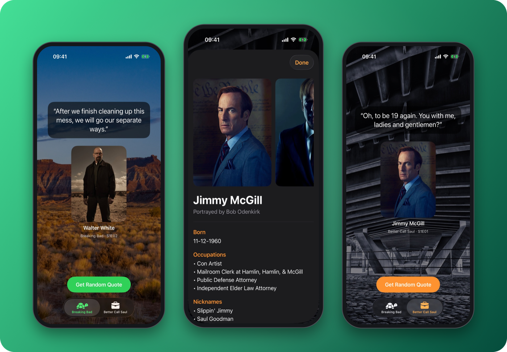
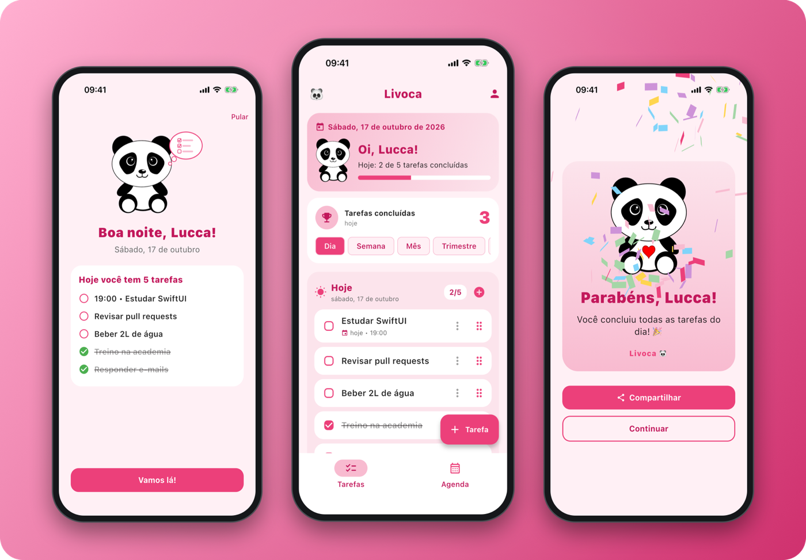
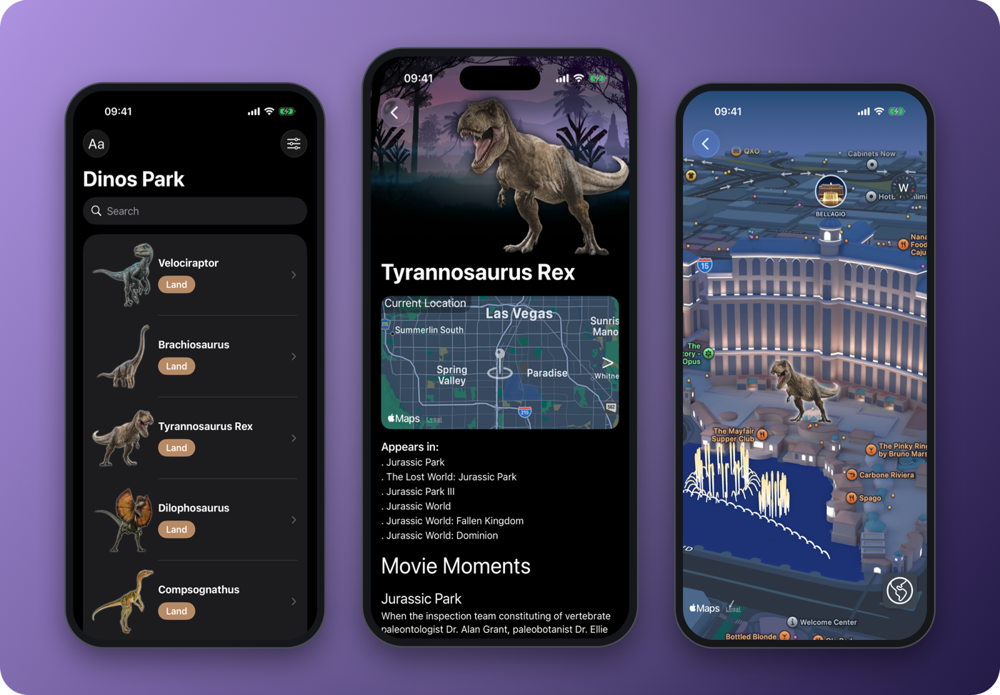
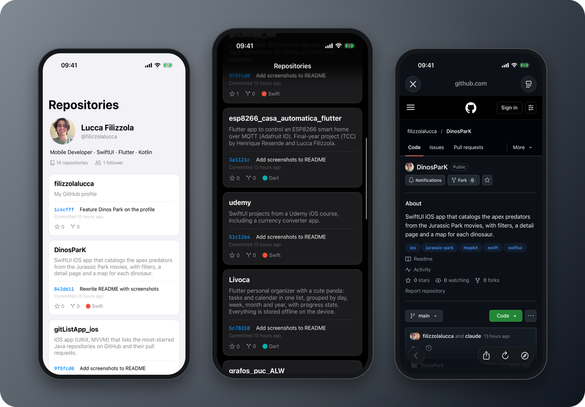
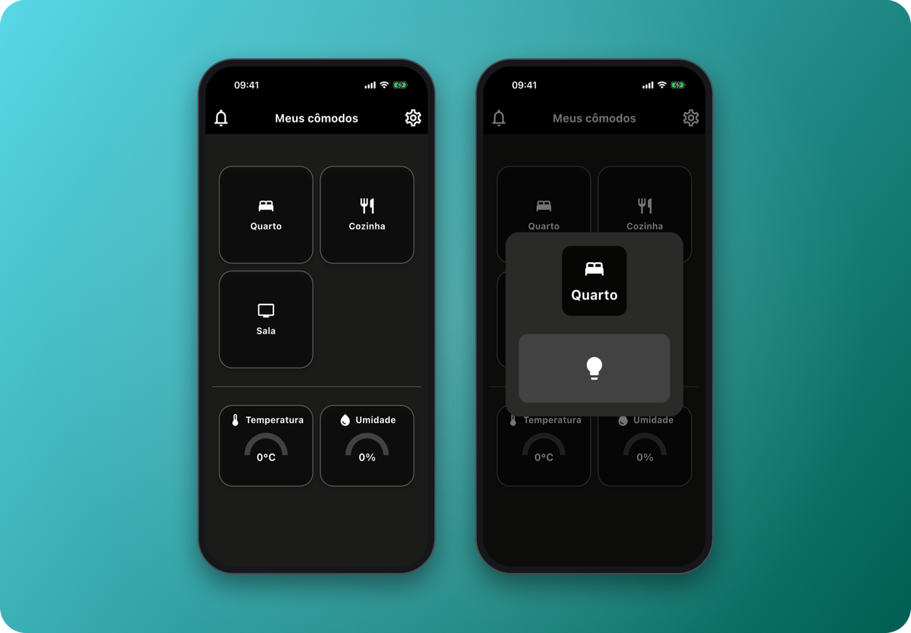
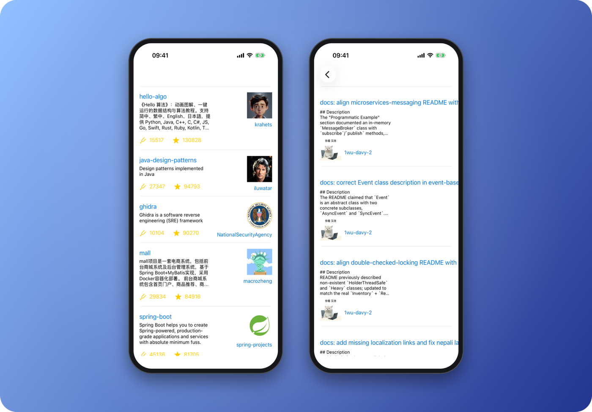
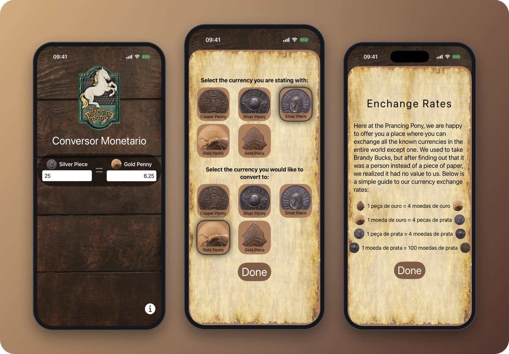

<picture>
  <source media="(prefers-color-scheme: dark)" srcset="assets/banner-dark.svg">
  
</picture>

 

I'm a **mobile developer** who enjoys turning ideas into polished, real apps. I build native iOS apps with **SwiftUI** and **UIKit**, Android apps with **Kotlin**, and cross-platform apps with **Flutter**. When an app needs a back end or some hardware, I build that too.

- 📱 **iOS**: SwiftUI, UIKit, async/await, Observation, MVVM
- 🤖 **Android**: Kotlin, MVVM, Koin, Retrofit, coroutines
- 💙 **Flutter**: Provider, get_it, local storage, MQTT, notifications
- 🔌 **IoT**: a smart home with an ESP8266 board and a Flutter app, my final-year project
- ⚙️ **Back end**: REST APIs with Go, NestJS and Node.js

 

## 📱 Featured apps

### BB Quotes · SwiftUI

Random quotes from *Breaking Bad* and *Better Call Saul*, the character who said each one and how they died. A single SwiftUI codebase that runs on iPhone, iPad, Mac and Apple Vision Pro.

`SwiftUI` `Swift 6` `async/await` `Observation` `MVVM` `REST API`

**[View repository →](https://github.com/filizzolalucca/bb_quotes)**

 

### Livoca · Flutter

A personal organizer with a cute panda. Tasks and calendar live in one place and are grouped by day, week, month and year, with a daily briefing, drag and drop and a confetti celebration when you finish everything. Works fully offline.

`Flutter` `Dart` `shared_preferences` `table_calendar` `Drag and drop` `Offline-first`

**[View repository →](https://github.com/filizzolalucca/Livoca)**

 

### Dinos Park · SwiftUI + MapKit

A catalog of the apex predators from the *Jurassic Park* movies, with search, filters and movie trivia. Each dinosaur has a live map preview that zooms into a 3D map with every predator pinned where it was seen.

`SwiftUI` `MapKit` `3D maps` `Zoom transitions` `Searchable` `Codable`

**[View repository →](https://github.com/filizzolalucca/DinosParK)**

 

### Repo Explorer · UIKit

A GitHub profile viewer built entirely in view code: profile header, repository cards with a shimmer skeleton, and each repository's latest commit loaded on demand as you scroll. MVVM with async/await, dark mode and no third-party libraries.

`UIKit` `View code` `MVVM` `async/await` `Skeleton loading` `GitHub API`

**[View repository →](https://github.com/filizzolalucca/repo-explorer)**

 

### Smart Home · Flutter + ESP8266

My final-year project: a house controlled from the phone. The Flutter app switches lights, shows live temperature and humidity, and sends push notifications when the presence sensor or doorbell is triggered. An ESP8266 board running C++ firmware talks to the app over MQTT.

`Flutter` `MQTT` `Adafruit IO` `Push notifications` `ESP8266` `C++`

**[App repository →](https://github.com/filizzolalucca/esp8266_casa_automatica_flutter)** · **[Firmware repository →](https://github.com/filizzolalucca/smart_home_tcc)**

 

### GitHub List · UIKit and Kotlin

The same app built natively twice, for iOS and Android: it lists the most-starred Java repositories on GitHub and their pull requests, using MVVM and dependency injection on both platforms.

`UIKit` `Alamofire` `Resolver` `Kotlin` `Koin` `Retrofit` `Coroutines`

**[iOS repository →](https://github.com/filizzolalucca/gitListApp_ios)** · **[Android repository →](https://github.com/filizzolalucca/GitHubList_android)**

 

### Prancing Pony Exchange · SwiftUI

A fantasy-themed currency converter: two-way conversion between gold, silver and copper coins, a coin picker grid, an exchange rates screen and onboarding hints with TipKit.

`SwiftUI` `TipKit` `UserDefaults` `LazyVGrid`

**[View repository →](https://github.com/filizzolalucca/udemy)**

 

## 🛠️ Tech stack

**Mobile**

**Back end and data**

**Web, hardware and tools**

 

## 🧩 More projects

| Project | What it is | Stack |
|---|---|---|
| [Sustainability Quiz](https://github.com/filizzolalucca/quiz_app_front_end_flutter) | Quiz app with accounts, subjects and score tracking, plus its [REST API](https://github.com/filizzolalucca/quiz_app_back_end) | Flutter, NestJS, Supabase |
| [Smart Home Firmware](https://github.com/filizzolalucca/smart_home_tcc) | ESP8266 firmware for lights, sensors, security and energy-saving modes | C++, PlatformIO, MQTT |
| [Portal dos Filmes](https://github.com/filizzolalucca/Portal_Filmes_web) | Movie portal with search and details, powered by the TMDB API | HTML, CSS, JavaScript |
| [Graph Library](https://github.com/filizzolalucca/grafos_puc_ALW) | Graphs with Dijkstra, Bellman-Ford, Floyd-Warshall and A* | Java |

 

Thanks for stopping by! ✨

